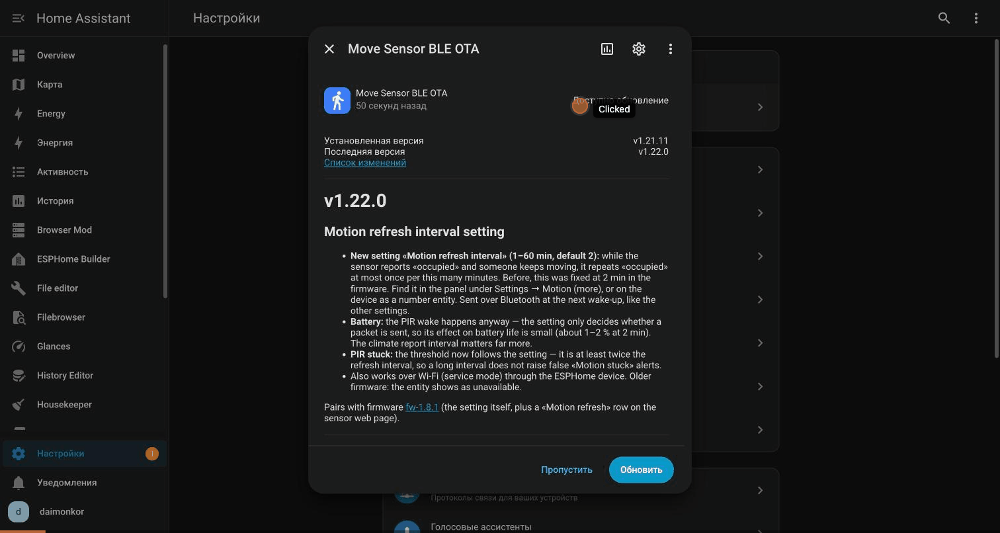

# Move Sensor BLE

**English** · [Русский](#русский)

A battery-powered PIR motion sensor on a **Seeed XIAO ESP32-C3** (SR602 PIR, SHT41, LiPo) running ESPHome
with **BTHome v2** over BLE and deep sleep — plus a Home Assistant custom integration,
**Move Sensor BLE OTA**, that flashes firmware and changes settings **over Bluetooth through ESPHome
Bluetooth proxies**. The sensor never needs Wi-Fi in normal operation.

### Quick start

From parts on the table to motion in Home Assistant. You need a Home Assistant with the **ESPHome Builder** add-on,
the **Bluetooth** integration and an **ESPHome Bluetooth proxy** near the sensor.

1. **Solder** the XIAO ESP32-C3, SR602 PIR, SHT41 and LiPo as in the header of
   [`esphome/move_sensor_ble/base.yaml`](esphome/move_sensor_ble/base.yaml) (pins, divider, LED, service switch).
2. **Copy the firmware** into Home Assistant: everything from `esphome/` → `/config/esphome/`.
3. **Secrets**: copy `secrets.example.yaml` into `/config/esphome/secrets.yaml` (or add its lines to yours) and fill in
   your router Wi-Fi, a password for the sensor's own access point and `move_sensor_ble_ota_key`
   — any long random string, e.g. `openssl rand -hex 16`. The integration reads the same key from this file.
4. **Your sensor's file**: copy `move-sensor-ble-148f98.yaml` → `move-sensor-ble-new.yaml`, set `name` /
   `friendly_name`. In ESPHome Builder: **Install → Plug into this computer** (USB, first flash only).
5. **Device ID**: the last 6 hex digits of the sensor's Wi-Fi MAC — they are in the ESPHome install log and in
   the access point name `MoveSensorBLE-XXXXXX` (service mode). Rename the file to `move-sensor-ble-<id>.yaml` and put the id into
   `name`; later builds over BLE look for exactly this file.
6. **BTHome**: wave in front of the sensor — Home Assistant discovers a **BTHome** device; add it.
   Set `ble_rssi_entity` in the sensor's file to its *Signal strength* entity.
7. **Integration**: the two buttons at the top → Marketplace → **Download** → restart → **Add integration** → pick
   the sensor. Leave **OTA key** empty — the key is taken from `secrets.yaml`.
8. **Check**: wave — *Occupancy* turns on and the LED flashes once; after *Keep time* it clears with two flashes.
   *Settings status* becomes *applied* after the first wake-up.

From now on: firmware — the **Firmware** update entity (*Install*) on the device page, no USB; settings — in Home Assistant
(v1.15: one *Move Sensor BLE* device with data from BLE or Wi-Fi, ESPHome/BTHome copies hidden, sidebar panel).
Wi-Fi is needed only in **service mode** (switch on D2, the LED flashes 3 times slowly): the sensor's site is at `http://100.64.4.1/` on its access
point. If the sensor rejects the OTA key, Home Assistant shows it in **Settings → Repairs**.

### Features

- **BLE OTA**: flash a new firmware over Bluetooth during the sensor's short wake window (button, service or REST).
- **Build & flash in one click** (the *Firmware* update entity since v1.15): the integration compiles the sensor's `move-sensor-ble-<device id>.yaml` in the ESPHome Builder add-on
  and flashes the result over BLE — no file downloads.
- **Settings over BLE**: detect delay, keep time, climate report interval, voltage factor, LED.
  Changes are queued and applied at the next wake-up; the sensor confirms them.
- **Diagnostics**: firmware version, brownout / crash counters, last reset reason (stored in NVS on the sensor).
- **Health sensors**: last seen, battery days left (trend since last charge), motion events / wakes per day,
  *PIR stuck* problem sensor.
- **Wi-Fi reset over BLE**: return the service-mode Wi-Fi to the firmware default.
- **Docs inside Home Assistant**: the integration serves its own documentation page.

### Install

1. Click **Open your Home Assistant instance and open a repository…** above → Home Assistant opens
   **Marketplace** (HA 2026.11+) or HACS with this repository → **Download** → restart Home Assistant.
2. Click **Add integration** → the *Move Sensor BLE OTA* setup flow opens → pick the BTHome sensor.

Manually: Settings → **Marketplace** → **Add from link** (HACS: ⋮ → *Custom repositories*) →
`https://github.com/daimonkor/move-sensor-ble-ota`, type *Integration*.

Requirements: the **Bluetooth** integration and at least one **ESPHome Bluetooth proxy** near the sensor
(active connections are on by default). The sensor firmware must include `ble_ota:` in the `bthome:` block.

### Update

New versions are published as GitHub releases. Home Assistant shows them under **Settings → Updates**
(or Marketplace → *Move Sensor BLE OTA* → ⋮ → **Update information** to check right away) →
**Update** → restart Home Assistant. Entities, settings and statistics are kept.

### Video

Clean install — README button → Marketplace → Download → setup → the sensor answers at its first wake-up:

Update to a new release through Marketplace:

### Repository layout

| Path | What |
|---|---|
| `custom_components/move_sensor_ble_ota/` | Home Assistant integration ([detailed docs, Russian](custom_components/move_sensor_ble_ota/README.md)) |
| `esphome/` | Sensor firmware: one YAML per sensor `move-sensor-ble-<device id>.yaml` + shared `move_sensor_ble/base.yaml`, `move_sensor_rtc.h`, service-mode web/AP `move_sensor_ble/`, external component `components/bthome` (BTHome + BLE OTA, DIAG, settings, Wi-Fi reset). Secrets template — `secrets.example.yaml` |
| `tools/ble_ota_flash.py` | Build + BLE flash from a terminal (stdlib Python only) |
| `sync_from_ha.sh` | Copy the firmware files (`esphome/`, `tools/`) from Home Assistant `/config` into this repo |

Issues and pull requests are disabled — this is a personal project published as-is.

---

## Русский

Батарейный датчик движения на **Seeed XIAO ESP32-C3** (PIR SR602, SHT41, LiPo) с **BTHome v2** по BLE
и deep sleep — и интеграция Home Assistant **Move Sensor BLE OTA** к нему: прошивка и настройки по BLE
через Bluetooth-прокси, диагностика, сборка прошивки одной кнопкой.

## Быстрый старт

От деталей на столе до движения в Home Assistant. Нужны Home Assistant с аддоном **ESPHome Builder**,
интеграция **Bluetooth** и **Bluetooth-прокси ESPHome** рядом с датчиком.

1. **Спаять** XIAO ESP32-C3, PIR SR602, SHT41 и LiPo по шапке
   [`esphome/move_sensor_ble/base.yaml`](esphome/move_sensor_ble/base.yaml) (пины, делитель, LED, сервисный переключатель).
2. **Скопировать прошивку** в Home Assistant: всё из `esphome/` → `/config/esphome/`.
3. **Секреты**: `secrets.example.yaml` → `/config/esphome/secrets.yaml` (или дописать строки в свой) и заполнить:
   Wi-Fi роутера, пароль своей точки доступа датчика и `move_sensor_ble_ota_key` — любая длинная случайная строка,
   например `openssl rand -hex 16`. Интеграция берёт тот же ключ из этого файла.
4. **Файл датчика**: скопировать `move-sensor-ble-148f98.yaml` → `move-sensor-ble-new.yaml`, поправить `name` /
   `friendly_name`. В ESPHome Builder: **Install → Plug into this computer** (USB, только первый раз).
5. **Device ID** — последние 6 hex-цифр MAC Wi-Fi датчика: они в логе установки ESPHome и в имени точки доступа
   `MoveSensorBLE-XXXXXX` (сервисный режим). Переименовать файл в `move-sensor-ble-<id>.yaml` и вписать id в `name`: сборка по BLE
   ищет именно этот файл.
6. **BTHome**: помахать перед датчиком — Home Assistant найдёт устройство **BTHome**, добавить его.
   В файле датчика указать `ble_rssi_entity` = его сущность *Signal strength*.
7. **Интеграция**: две кнопки вверху README → Marketplace → **Скачать** → перезапуск → **Add integration** → выбрать
   датчик. Поле **Ключ OTA** оставить пустым — ключ возьмётся из `secrets.yaml`.
8. **Проверка**: помахать — *Occupancy* включается, LED мигает 1 раз; через *Keep time* — «свободно» и 2 вспышки.
   *Settings status* после первого пробуждения — *applied*.

Дальше: прошивка — сущность обновления **Firmware** («Установить») на странице устройства, без USB; настройки — в Home Assistant
(v1.15: одно устройство *Move Sensor BLE* с данными из BLE или Wi-Fi, копии ESPHome/BTHome скрыты, панель в меню).
Wi-Fi нужен только в **сервисном режиме** (переключатель на D2, LED — 3 медленные вспышки): сайт датчика — `http://100.64.4.1/` на его точке
доступа. Если датчик не принял ключ OTA, Home Assistant покажет это в **Настройки → Ремонт**.

| Папка | Что |
|---|---|
| `custom_components/move_sensor_ble_ota/` | Интеграция HA (ставится через HACS как custom repository). Подробно — [её README](custom_components/move_sensor_ble_ota/README.md) |
| `esphome/` | Прошивка датчика: свой YAML на датчик `move-sensor-ble-<device id>.yaml` + общая `move_sensor_ble/base.yaml`, `move_sensor_rtc.h`, сайт/точка доступа `move_sensor_ble/`, компонент `components/bthome` (BTHome + BLE OTA, DIAG, настройки, сброс Wi-Fi, быстрый тест). Секреты — `secrets.example.yaml` |
| `tools/ble_ota_flash.py` | Сборка + прошивка по BLE из терминала, без браузера (только stdlib Python) |
| `sync_from_ha.sh` | Скопировать файлы прошивки (`esphome/`, `tools/`) из `/Volumes/config` в репозиторий |

## Работа с репозиторием

- **Интеграция** (`custom_components/`) — источник здесь. Правка → коммит → поднять `version` в `manifest.json` и
  значок версии в `docs/index*.html` → push → GitHub-релиз с тегом `vX.Y.Z`. В HA обновление приходит через
  **Marketplace** (Настройки → Marketplace → Move Sensor BLE OTA → Обновить), без ручного копирования в `/config`.
- **Прошивка** (`esphome/`) — рабочая копия в `/config/esphome`. Перед коммитом: `./sync_from_ha.sh`.

## Установка интеграции

1. Кнопка **Open your Home Assistant instance and open a repository…** → адрес своего HA (один раз) →
   откроется Marketplace (HA 2026.11+) или HACS с этим репозиторием → **Скачать** → перезапустить HA.
2. Кнопка **Add integration** → мастер *Move Sensor BLE OTA* → выбрать датчик.

Вручную: Настройки → **Marketplace** → **Добавить по ссылке** (в HACS: ⋮ → *Custom repositories*) →
`https://github.com/daimonkor/move-sensor-ble-ota`, тип *Integration*.

Прошивку датчика собрать из `esphome/` (скопировать в `/config/esphome/`, секреты по `secrets.example.yaml`).

## Обновление

Новая версия — это GitHub-релиз. HA покажет её в **Настройки → Обновления** (проверить сразу:
Marketplace → *Move Sensor BLE OTA* → ⋮ → **Обновить информацию**) → **Обновить** → перезапустить HA.
Сущности, настройки и статистика сохраняются.

## Видео

Установка с нуля (кнопка в README → Marketplace → установка → мастер → датчик ответил в первое окно) и
обновление до нового релиза — выше, в английском разделе: [установка](media/install.gif), [обновление](media/update.gif).

## Публикация

`./tools/set_github.sh <github-логин>` — подставит логин вместо `OWNER` в README, доки и `manifest.json`
(`codeowners`). Для обновлений в Marketplace — GitHub-релиз с тегом = `version` из `manifest.json`.
