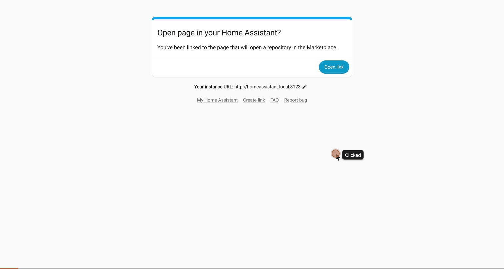

# Move Sensor BLE

**English** · [Русский](#русский)

A battery-powered PIR motion sensor on a **Seeed XIAO ESP32-C3** (SR602 PIR, SHT41, LiPo) running ESPHome
with **BTHome v2** over BLE and deep sleep — plus a Home Assistant integration, **Move Sensor BLE OTA**:
one *Move Sensor BLE* device with data and settings from BLE or Wi-Fi, firmware updates over Bluetooth through
ESPHome Bluetooth proxies (or Wi-Fi in service mode), a sidebar panel with Overview / Settings / Advanced tabs on Home Assistant's
own cards, and Repairs notifications for a low or empty battery and a silent sensor. The sensor never needs Wi-Fi in normal operation.

## 📖 Documentation

**[daimonkor.github.io/move-sensor-ble-ota](https://daimonkor.github.io/move-sensor-ble-ota/index.en.html)** —
quick start (from parts to motion in HA), install, setup, firmware, sensor settings, entities, API, BLE protocol,
troubleshooting. English · [Русский](https://daimonkor.github.io/move-sensor-ble-ota/?lang=ru) · [Українська](https://daimonkor.github.io/move-sensor-ble-ota/index.uk.html).
The same pages open inside Home Assistant: integration page → **Documentation** (in the HA user's language).

## Install

The buttons above → **Marketplace** (HA 2026.11+) or HACS → **Download** → restart → **Add integration** → pick the sensor.
Manually: Settings → Marketplace → **Add from link** → `https://github.com/daimonkor/move-sensor-ble-ota`, type *Integration*.
The BTHome integration is not needed — the sensor is found by its BLE advertising.
Updates come as GitHub releases under **Settings → Updates**.

## Video

| Clean install | Update |
|---|---|
|  |  |

## Repository

| Path | What |
|---|---|
| `custom_components/move_sensor_ble_ota/` | Home Assistant integration; `docs/` — the documentation (shown in HA and on GitHub Pages) |
| `esphome/` | Sensor firmware: `move-sensor-ble-<device id>.yaml` per sensor + shared `move_sensor_ble/`, `move_sensor_rtc.h`, component `components/bthome` (BTHome + BLE OTA, settings, DIAG). Secrets template — `secrets.example.yaml` |
| `tools/ble_ota_flash.py` | Build + BLE flash from a terminal (stdlib Python) |
| `sync_from_ha.sh` | Copy the firmware from Home Assistant `/config` into this repo |

Issues and pull requests are disabled — a personal project published as-is.

---

## Русский

Батарейный датчик движения на **Seeed XIAO ESP32-C3** (PIR SR602, SHT41, LiPo) с **BTHome v2** по BLE и deep sleep —
и интеграция Home Assistant **Move Sensor BLE OTA**: одно устройство *Move Sensor BLE* с данными и настройками из BLE или
Wi-Fi, прошивка по Bluetooth через прокси ESPHome (или по Wi-Fi в сервисном режиме), панель в меню с табами Overview / Settings /
Advanced на стандартных карточках Home Assistant и уведомления в «Ремонте» о севшей батарее и пропавшем датчике. Wi-Fi датчику
в обычной работе не нужен.

**📖 Документация: [daimonkor.github.io/move-sensor-ble-ota](https://daimonkor.github.io/move-sensor-ble-ota/?lang=ru)** —
быстрый старт (от деталей до движения в HA), установка, настройка, прошивка, настройки датчика, сущности, API, протокол,
диагностика. Те же страницы — внутри Home Assistant: страница интеграции → **Документация** (на языке пользователя HA).
Українською: [daimonkor.github.io/move-sensor-ble-ota/index.uk.html](https://daimonkor.github.io/move-sensor-ble-ota/index.uk.html).

**Установка**: кнопки вверху → **Marketplace** (HA 2026.11+) или HACS → **Скачать** → перезапуск → **Добавить интеграцию** →
выбрать датчик. Интеграция BTHome не нужна. Обновления — GitHub-релизы, приходят в **Настройки → Обновления**. Видео — выше.

**Работа с репозиторием**: интеграция — источник здесь (правка → `version` в `manifest.json` и значок в `docs/index*.html` →
push → релиз `vX.Y.Z`); прошивка — рабочая копия в `/config/esphome`, перед коммитом `./sync_from_ha.sh`. Документация —
только `custom_components/move_sensor_ble_ota/docs/` (RU `index.html`, UK `index.uk.html`, EN `index.en.html`), на GitHub Pages публикуется сама.
**CHANGELOG прошивки** — `esphome/move_sensor_ble/CHANGELOG.md` (его показывает карточка обновления прошивки в HA).
Коммиты прошивки — текстом для пользователя: `feat(fw): …`, `fix(fw): …`, `change(fw): …` (`chore/refactor/docs(fw)` в
CHANGELOG не попадают). `python3 tools/changelog.py draft` — черновик «Не выпущено» из коммитов, `release X.Y.Z` — версия
с датой (пункты потом перечитать глазами пользователя), CHANGELOG копируется и в HA.
